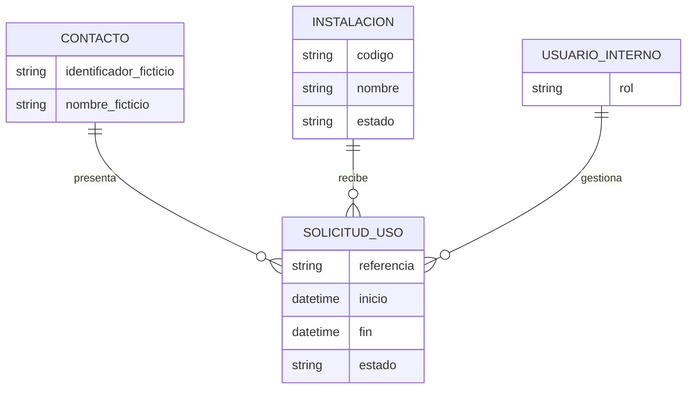

# Diseño inicial de la necesidad

Este documento contiene el diseño previo de E1 de forma . 
## Proceso inicial propuesto

1. Una persona responsable registra una instalación y sus datos básicos.
2. Una persona solicitante pide el uso de una instalación en una fecha y franja horaria.
3. El personal responsable revisa la solicitud y registra si queda aceptada, rechazada o pendiente.

## Relaciones conceptuales de datos

La disponibilidad, las reglas contra solapamientos y los campos definitivos se concretarán antes del módulo siguiente, L2.

## Permisos conceptuales

| Perfil propuesto | Acciones iniciales | Estado |
|---|---|---|
| Administración | Configurar instalaciones, usuarios y parámetros | Por validar |
| Personal gestor | Consultar y resolver solicitudes; mantener disponibilidad | Por validar |
| Persona solicitante | Crear solicitudes y consultar las propias | Por validar; portal aún no configurado |

## Dos supuestos organizativos que se probarán en E2

1. **Gestión básica:** un perfil interno gestiona instalaciones y solicitudes; las personas solicitantes solo consultan o crean sus solicitudes de prueba.
2. **Gestión separada por roles:** administración mantiene la configuración, el personal gestor procesa solicitudes y las personas solicitantes acceden solo a sus propias solicitudes.

Ambos escenarios han sido probados de manera estándar sin añadir funciones o módulos propios.
